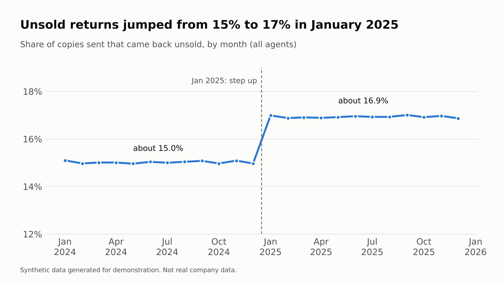
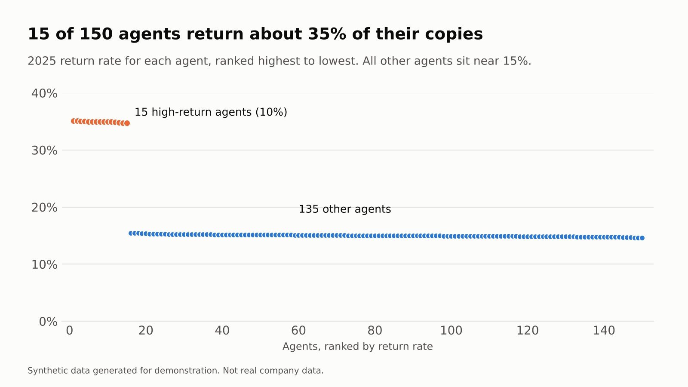
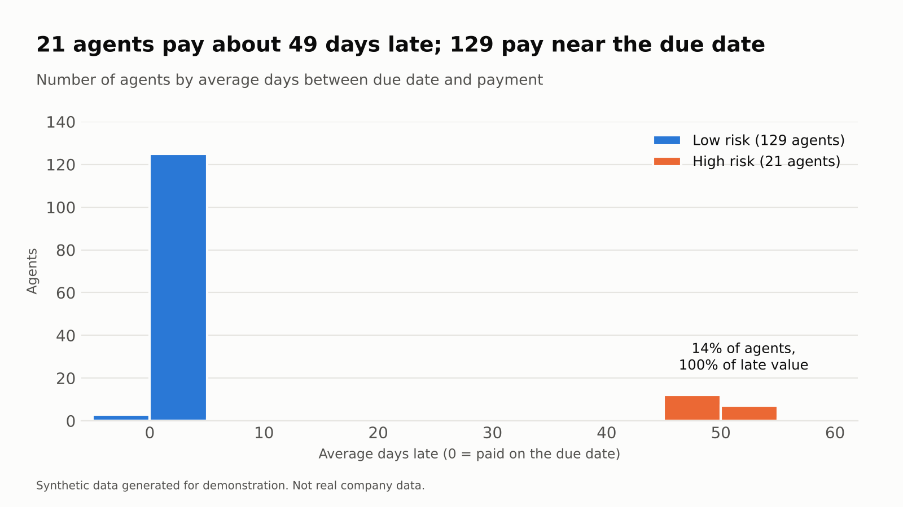
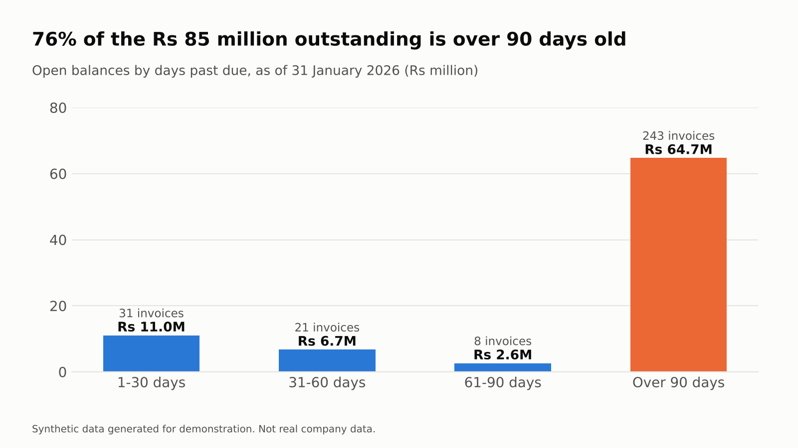
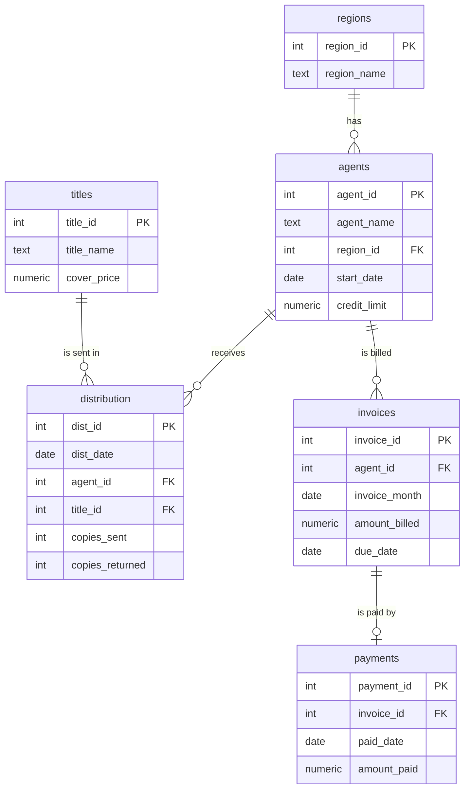

# Newspaper Circulation and Credit Risk Analytics (SQL Case Study)

A PostgreSQL case study on newspaper distribution: which agents return too many unsold copies, who pays late, and how much money is stuck in old invoices.

> **All data in this project is synthetic.** It was randomly generated for demonstration and does not represent any real company, agent or payment.

**Author:** Maheesha Piyumanthi Gunathilake | [LinkedIn](https://www.linkedin.com/in/maheesha-gunathilake)
**Tools:** PostgreSQL 16, pgAdmin, SQL (CTEs, window functions, views, indexes), Python and matplotlib for the charts

---

## Business questions

1. Which regions and titles sell the most, and where do unsold returns come from?
2. Did the return rate change over time, and which agents are responsible?
3. Which agents pay late, and how concentrated is late payment?
4. How much money is outstanding, and how old is it?

## Key findings

All figures come from the queries in [`queries/`](queries/). Money is in Rs.

**1. Returns jumped in January 2025, and 15 agents explain it.**
The share of copies returned unsold rose from 15.0% in 2024 to 16.9% in 2025, a step change in January 2025 that never reversed, while copies sent stayed flat (12.96M vs 12.93M). Net copies sold fell 2.5%, and net sales value fell from Rs 1,101.6M to Rs 1,074.1M (Rs 27.5M).



**2. The cause is a small group of agents.**
15 of 150 agents (10%) returned more than 25% of their copies in every month of 2025, averaging 34.9%, against 15.0% for all other agents. Their returns above the normal rate come to about 249,000 copies, worth about Rs 24.9M at cover price, roughly 90% of the fall in net sales value. These agents are concentrated in four regions (Colombo, Kandy, Kurunegala and Matara).



**3. Late payment is concentrated in 21 agents.**
21 agents (14%) pay 49 days late on average; the other 129 pay within about 2 days of the due date on average (none averages more than 6). Those 21 agents account for 100% of the Rs 165.2M paid more than 30 days late.



**4. Most of the outstanding balance is old.**
As of 31 January 2026, Rs 85.1M was outstanding across 303 invoices, and 76% of it (Rs 64.7M, 243 invoices) was over 90 days past due. In total, Rs 72.0M of the Rs 1,523.0M billed (4.7%) was not recovered: 102 invoices had no payment (Rs 43.3M) and 170 were only partly paid (Rs 28.8M short).



**5. A calendar effect hides the real trend in billing.**
Month-to-month billing changes of up to 10% look dramatic, but most of that is the number of days in the month. Billing per day was flat at about Rs 2.11M through 2024 and dropped about 2.2% to about Rs 2.06M from January 2025, matching the return-rate step.

### What I would recommend

- Review the supply to the 15 high-return agents. They are sent more copies than they sell.
- Put the 21 slow payers on shorter credit terms or a stricter follow-up routine.
- Review the 243 invoices older than 90 days for escalation or write-off.

## Data model



The database holds 8 regions, 3 titles, 150 agents, 328,950 daily distribution rows (2024 to 2025), 3,600 monthly invoices and about 3,500 payments. A fixed random seed makes the data identical on every run, and two patterns are built into it for the analysis to find: a group of agents with high returns from 2025, and a group of agents who pay late.

## Skills shown

| Skill | Where |
| --- | --- |
| Joins across 3 tables, aggregation, `HAVING` | Q1, Q3, Q4 |
| Date functions (`DATE_TRUNC`, `EXTRACT`, date arithmetic) | Q2, Q3, Q6, Q10 |
| CTEs, including chained CTEs | Q5, Q5b, Q6, Q7 |
| `CASE`, `LEFT JOIN`, ageing analysis as of a report date | Q7, Q8 |
| Window functions (`RANK`, `LAG`, `SUM() OVER`) | Q9, Q10, Q11b |
| Views for reuse (`v_agent_risk`) | Q11 |
| Data quality checks | Q12 |
| Indexing and `EXPLAIN ANALYZE` (24 ms to 0.17 ms on 329k rows) | Q13 |

## Repository structure

```
schema/01_schema_and_data.sql                       creates the tables and the synthetic data
queries/02_basics_and_joins.sql                     Q1-Q4
queries/03_ctes_dates_and_credit_risk.sql           Q5-Q8
queries/04_window_functions_views_and_indexes.sql   Q9-Q13
images/                                             charts used above
```

## How to run

1. Install PostgreSQL (which includes pgAdmin) and create an empty database called `newspaper_db`.
2. In pgAdmin, open a Query Tool on `newspaper_db`, open `schema/01_schema_and_data.sql` and press F5. This takes 10 to 60 seconds. The script can be re-run safely.
3. Open and run the three files in `queries/` in order, one query at a time (select it, then press F5).

## Notes and limitations

- The numbers above come from a run on PostgreSQL 16. Other versions may give slightly different random data, so figures such as exact rupee totals may differ a little, but the patterns will be the same. The index timings depend on your computer.
- The data is simplified. Real distribution data would also include public holidays, seasonality, supply changes and part-month agents.
- "Estimated value at cover price" uses the cover price, not the agent's price or the cost of printing.
